<div align="center">

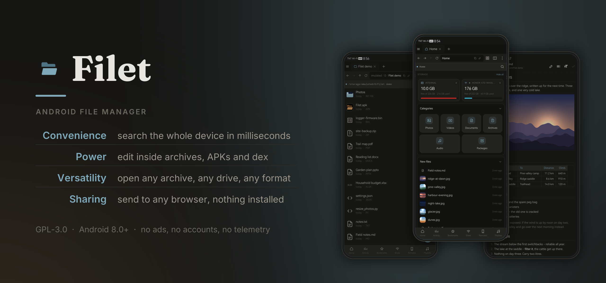

[](LICENSE)
[](#building-it-yourself)
[](#building-it-yourself)
[](https://github.com/uukjtisa/filet/releases/latest)
[](docs/FIXES.md)
[](https://ko-fi.com/thethirdy2007)

### PC-grade tools and native viewers, in a file manager that looks the part.

Built by **[Niccc2007](https://github.com/uukjtisa)**. Free and open source, always.

</div>

> [!WARNING]
> **Early development.** I built this for my own phone and I'm still finding things wrong with
> it. There's no store listing - [Releases](https://github.com/uukjtisa/filet/releases) is the
> only place it comes from. Everything below is what the code does today, except the section
> that says it is a plan.

---

## Table of Contents

- [What Filet is](#what-filet-is)
- [A glimpse of it](#a-glimpse-of-it)
- [Support Filet](#support-filet)
- [The tools](#the-tools)
- [The viewers](#the-viewers)
- [Finding things](#finding-things)
- [Your phone and your network](#your-phone-and-your-network)
- [Where it's going](#where-its-going)
- [Installing it](#installing-it)
- [How it's built](#how-its-built)
- [Building it yourself](#building-it-yourself)
- [Permissions](#permissions)
- [Licence](#licence)

---

## What Filet is

A general file manager with the tools you would normally go to a PC for built in, and its own
viewers for the files you open every day - so a document, an archive or an app package opens
*in* Filet instead of bouncing you to three other apps. Four things it won't trade against each
other:

- **Productivity** - search the whole phone in milliseconds, work in two panes, and keep your
  usual places a tap away.
- **Power** - edit a file inside an archive, take an app apart and rebuild it, change raw bytes,
  and script the lot in Lua.
- **Aesthetics** - a real palette and real motion, holding up on phone, tablet and landscape.
- **Convenience** - read Markdown, Word, slides, PDFs and spreadsheets where they lie, and share
  to any browser on your network with nothing installed at the other end.

Free and open source. No ads, no accounts, no telemetry, no paid tier.

---

## A glimpse of it

<p align="center">
  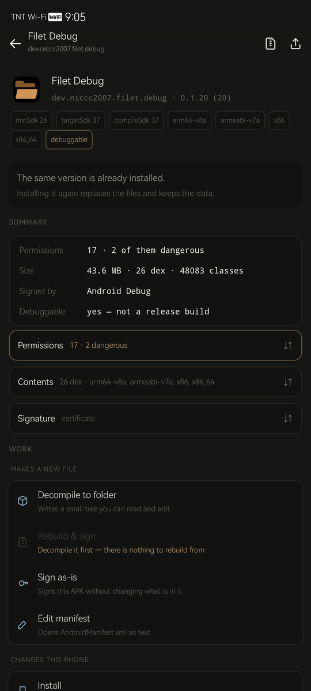
  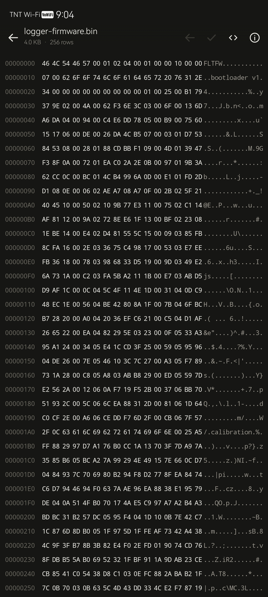
  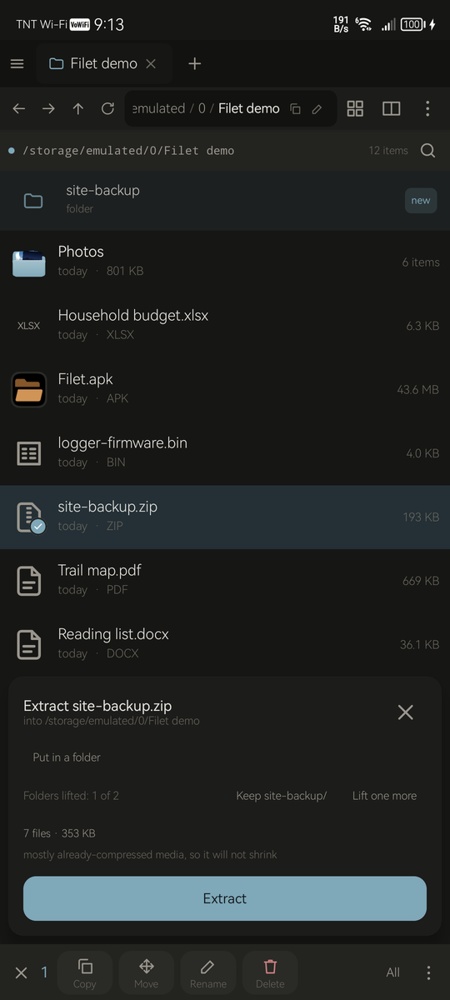
  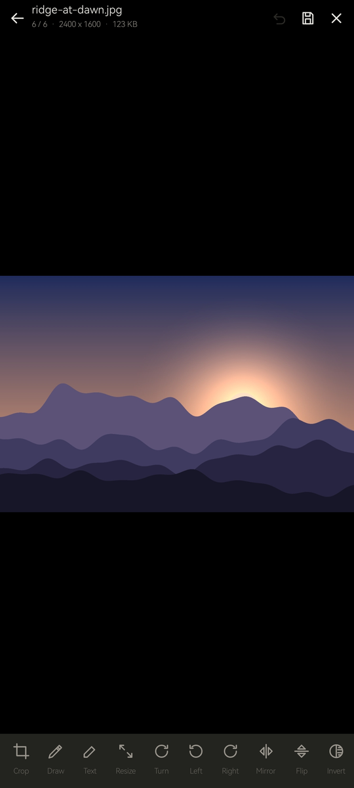
</p>

<p align="center"><sub>
The <b>APK inspector</b> reads a package before anything is installed - permissions, dex, signer -
and decompiles, signs or edits its manifest &middot; <b>hex</b>, where a changed byte is staged
until you save &middot; an <b>extraction</b> previewed <i>before</i> it happens, the folder it
will make already standing in the list and a doubled parent lifted one level at a time &middot;
and an <b>image editor</b> that crops, draws, writes, resizes, turns and flips
</sub></p>

<p align="center">
  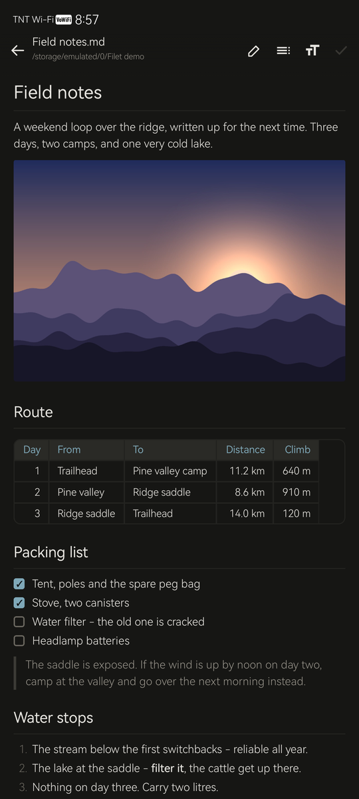
  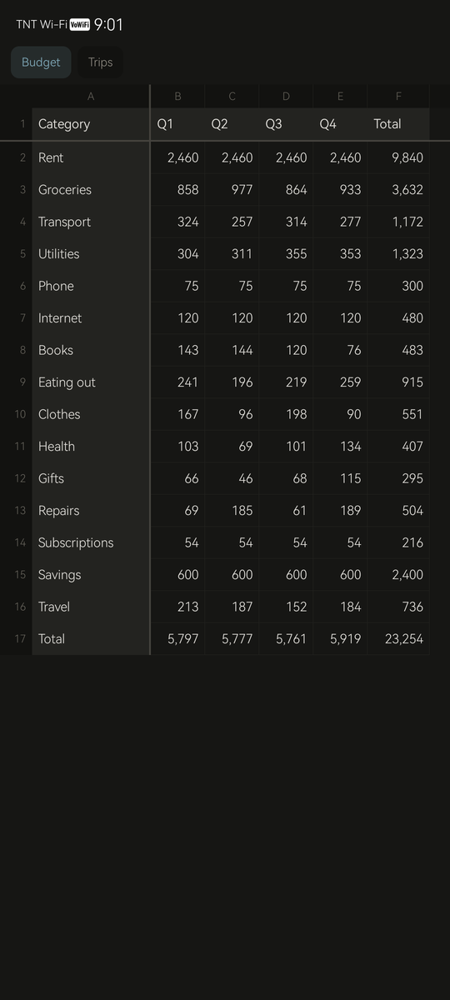
  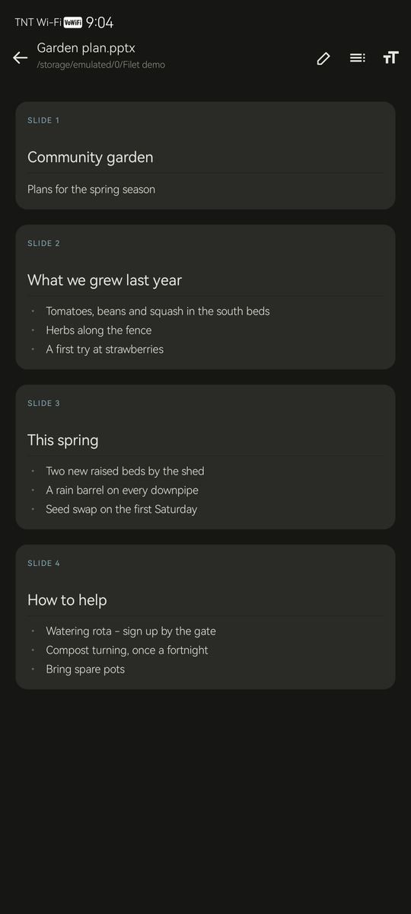
  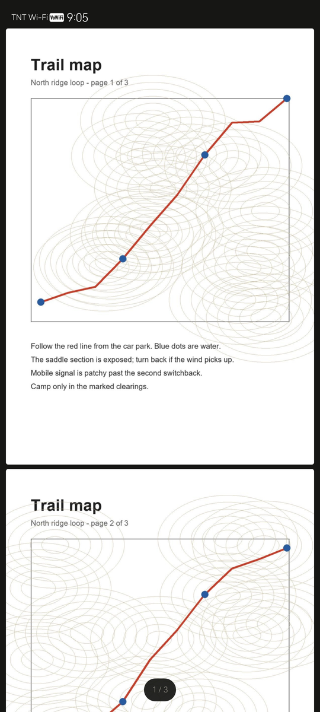
</p>

<p align="center"><sub>
Readers built in rather than handed off: <b>Markdown</b> as a page, pictures and tables
included &middot; <b>spreadsheets</b> with their tabs and frozen headers &middot; <b>slides</b>
&middot; and <b>PDF</b>. Word documents open in the same reader
</sub></p>

<p align="center">
  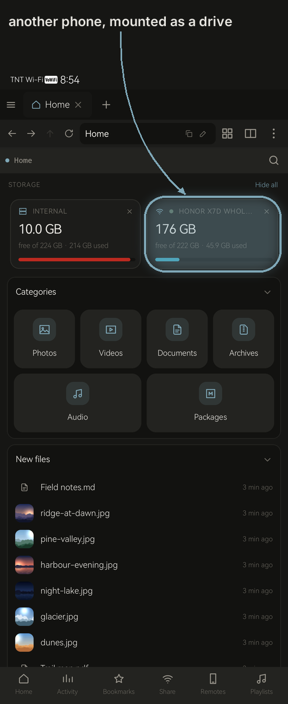
  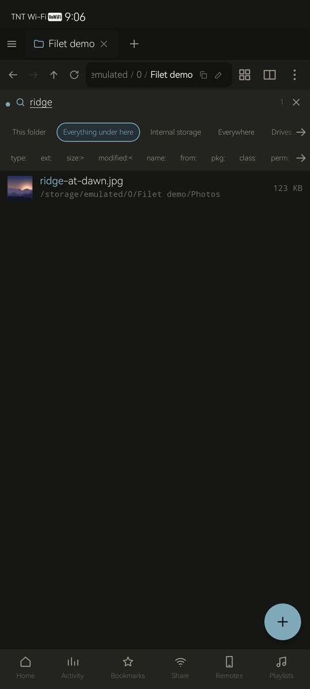
  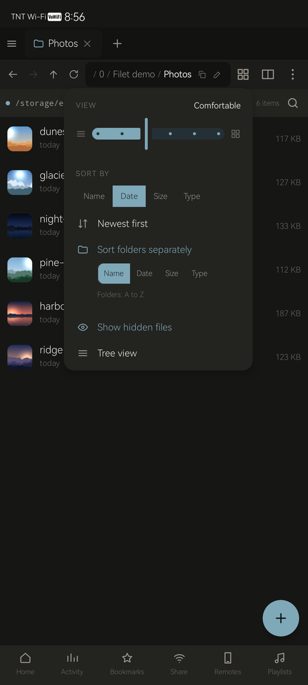
  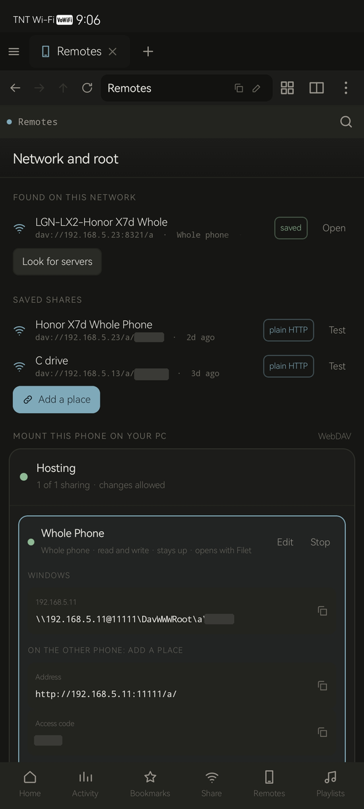
</p>

<p align="center"><sub>
<b>Another phone on the network sits beside internal storage</b> as a tile like any other, the
bar under each coloured by how full it is &middot; <b>search</b> that reaches from the folder you
are in out to every drive, with filters for size, date, package, class and permission &middot;
one <b>view</b> menu for density, sort and the tree &middot; and <b>Remotes</b>, which both mounts
other machines and hosts this phone as a drive on yours
</sub></p>

<p align="center"><sub>
Screenshots use a seeded demo folder, not real files. The lists that are nothing <i>but</i>
personal data &mdash; recents, bookmarks, pinned shortcuts &mdash; are left out rather than
staged, and the share access codes are redacted. The banner at the top and the ringed copy above
are both built from these same files by <code>tools/make-glimpse.py</code>; the files themselves
are never annotated.
</sub></p>

---

<div align="center">

## Support Filet

**Filet is independent.** It is built by one student, in the hours around studying, and every
line of it is shared.<br>
There is no company behind it and no paid tier coming - nothing is locked and nothing ever will be.

**Support goes straight to me**, and it buys the time and the test phones that keep Filet moving.

<a href="https://ko-fi.com/thethirdy2007"></a>

<sub>If it is not for you, the app is exactly the same. It never asks: the only mention of this
inside it is one row on the About screen.</sub>

</div>

---

## The tools

The things a phone file manager usually sends you to a PC for.

### Archives

- **Walk into an archive as if it were a folder** - zip and everything zip-shaped (apk, jar,
  epub, cbz), tar on its own or through gzip, bzip2 or xz, 7z, and RAR and RAR5 including solid
  archives
- **See the extraction before it happens.** The destination is drawn as it will be: the folder
  about to be made, a pointless parent folder lifted away, what would be overwritten, whether it
  fits, and anything that tried to write outside the folder. The preview and the extractor are
  the same plan, not a drawing of what a separate piece of code might do
- **Edit a file inside an archive** and save it back. A zip re-compresses only the file you
  changed; a `tar.gz` or a 7z has to be rebuilt whole, and it says so, with the size, first
- **Make one** in zip, tar, tar.gz, tar.bz2, tar.xz or 7z, with real AES-256 zip encryption,
  split volumes, and an honest estimate of what it will weigh
- **RAR reads, and Filet cannot create one.** Every RAR writer descends from source whose licence
  a GPL-3 app cannot accept; the readers Filet ships are libarchive's independent ones.
  [`core-native/`](core-native/README.md) has the whole measurement
- **A 7z cannot be given a password here**, for the same kind of reason: nothing Filet can
  legally ship writes an encrypted 7z. Use zip if the archive needs a password

### App packages

- **Inspect** signature schemes, signer, SDK levels, native ABIs and protection status
- **`classes.dex` opens as a tree of smali** you can read and edit
- **Edit the binary manifest** without aapt2
- **Rebuild, re-sign and install**, on the phone, with the dex format chosen for the device it is
  going to
- **Search inside apps** - `pkg:`, `perm:` and `class:` find them by what they are, not their
  file names

### Bytes, pictures and tags

- **A hex editor, not a viewer.** Tap a byte and type; edits are staged and counted until one
  write applies them all
- **An image editor** that rotates to any angle, crops, draws, resizes and adds text
- **Tags and cover art, read and written** in MP3, FLAC, Ogg, Opus, MP4 and M4A, and document
  properties in PDF and Office files. Nothing is written in place: a rewrite is built, re-read,
  and only then replaces the original

### Scripting

- **Lua that can only touch what it declared.** A script states its permissions up front and you
  approve them before it runs. No `io`, no `os.execute`, no network
- **It works wherever the files are** - inside an archive or on a network share as much as on
  internal storage
- **Seven worked examples**, and a copyable prompt that explains the whole API to an AI agent

---

## The viewers

Filet opens a file rather than handing it away, and every viewer works the same inside an archive
and on a network share as it does on internal storage.

- **Documents** - Markdown the way GitHub draws it, with tables, alerts, code blocks you can
  resize and pictures at their real size; Word documents, PowerPoint slides, PDFs and
  spreadsheets with frozen rows and smooth pinch zoom; HTML, rendered or edited. A link from one
  file to another opens it, and Back brings you to the exact place you left
- **Code and text**, highlighted with TextMate grammars and tree-sitter, in a real editor
- **Pictures and video**, swiped through together, with the video player's gestures kept out of
  each other's way
- **Audio**, with playlists built from your own files
- **A QR scanner**, which reads what the code actually is - a payment code shows who it pays
- **Metadata, APK internals and archives**, as above

**Every one of these gets better with each release, and more viewers are on the way.** Filet's
aim is that a file on your phone never needs another app to be read properly.

---

## Finding things

- **Whole-phone search in milliseconds**, fuzzy and typo-tolerant, ranked by what you actually
  open. `dwnld` finds Downloads
- **A query language** - `type: size: modified: in: pkg: perm: inzip: dup:` with AND, OR and NOT.
  Bad syntax falls back to a plain search instead of an error
- **Every hit is checked against the disk before it is shown**, so a stale index never shows you
  a stale result
- **New files** - not when a file was made, but when it turned up on your phone
- **Photos, videos and music from the whole phone**, grouped by date, latest first
- **Shortcuts that survive a move.** A pinned shortcut follows its file when the file moves, and
  says so when it is deleted

---

## Your phone and your network

- **Share to any browser** on your network, with nothing installed on the other machine. A PIN
  by default, a QR code to open it, every session listed and revocable, and a 4 GB video
  streamed without a copy
- **Host this phone as a drive** on your PC
- **Mount other machines** over WebDAV, SMB, SFTP and FTP, as a storage tile beside internal
  storage. WebDAV is proven against a real server; SMB, SFTP and FTP are written and are the
  next thing to be proven against real ones - see below

---

## Where it's going

The big pieces still to come. The full plan, with the test each one has to pass, is
[`docs/PLAN.md`](docs/PLAN.md).

- **Network drives that just work** - find a PC by its name instead of its IP address, play a
  film off a share without downloading it, and have a big copy survive the Wi-Fi dropping. The
  phone itself showing up in Windows' Network folder
- **Cloud drives** - OneDrive or Dropbox first, then Google Drive, browsed, searched and copied
  exactly like a local folder
- **APK reverse engineering, taken much further** - a code editor with jump-to-definition and a
  symbol pane you drive without the keyboard, and split packages (XAPK, APKM, APKS) merged into
  one installable APK
- **An automation server** - an agent on your network driving Filet end to end: files, Lua, and
  a smali-level change to an app, rebuilt and installed without a hand on the phone
- **More viewers**, and better ones

---

## Installing it

Grab the APK from **[Releases](https://github.com/uukjtisa/filet/releases/latest)**. Android 8.0
or newer, one file, every phone.

You will have to allow installing from unknown sources, and Android will call the installer
untrusted: the APK is signed with my own key rather than a store key, which is what a sideloaded
build looks like. That key is also why an update has to come from the same place the first
install did.

Once it is installed, **About** has a **Check for updates** button that asks GitHub directly. It
is compiled out of the `fdroid` flavour, because F-Droid updates its own apps and refuses ones
that update themselves.

---

## How it's built

Six layers, and only the bottom one is allowed to touch a filesystem.

| Layer | What lives there |
|---|---|
| **L5** Surfaces | Compose UI, panes, tabs, split view |
| **L4** Runtime | Lua scripts, background jobs, the activity ledger |
| **L3** Handlers | Viewers, editors, the APK toolchain |
| **L2** Routing | What opens what, inbound and internal |
| **L1** Index | SQLite FTS5 and trigram, retrieve then rerank |
| **L0** VFS | `FileSystemProvider` per backend, `VPath`, `VNode` |

Nothing above L0 constructs a platform path, and `tools/check-r3.mjs` fails the build if one
turns up. That one constraint is why archives, network shares, SAF grants and root all work
through a single code path, and why every viewer above works on all of them.

Everything is checked rather than claimed:

- **[`docs/FEATURES.md`](docs/FEATURES.md)** is the feature register, with per-feature notes
- **[`docs/GATES.md`](docs/GATES.md)** is the per-milestone evidence, including the one gate that
  was abandoned and why
- **[`docs/FIXES.md`](docs/FIXES.md)** tracks every bug found in review to a demonstrated outcome
- **[`docs/PLAN.md`](docs/PLAN.md)**, **[`docs/SEARCH.md`](docs/SEARCH.md)** and
  **[`docs/NEARBY.md`](docs/NEARBY.md)** are the design documents
- **[`docs/RELEASES.md`](docs/RELEASES.md)** is how a release body has to be written, because the
  app renders it and for most people it is the only documentation they will ever read

Over two thousand JVM tests, fifty-one source checkers that each prove they catch what they are
for, and on-device tests for what only a phone can show.

---

## Building it yourself

You'll need the Android SDK and a JDK 21. Android Studio's bundled JBR is the one that's known
to work, and `gw.sh` points `JAVA_HOME` at it.

```bash
git clone https://github.com/uukjtisa/filet
cd filet
./gw.sh :app:assembleGithubDebug
adb install -r -g app/build/outputs/apk/github/debug/app-github-debug.apk
```

Two flavours:

- **`github`** has the in-app updater
- **`fdroid`** compiles it out, because F-Droid forbids an app that updates itself

Debug builds get a `.debug` application ID so they sit beside a release one. `minSdk 26`,
`targetSdk 37`, Kotlin 2.2, Compose Material3.

### Running the checks

```bash
./gw.sh :core-vfs:test :core-index:test :app:testGithubDebugUnitTest   # JVM suites
node tools/check-all.mjs                                               # every source checker
./tools/run-gates.sh <adb-serial>                                      # on-device tests
```

`run-gates.sh` exists because `connectedAndroidTest` reinstalls the app between runs, which
resets the all-files appop and deletes the artifacts the tests just wrote. Both look like
feature failures and are neither. It installs once, grants, runs the instrumentation directly,
and collects what the tests produced.

`tools/testservers/webdav.py` is a small WebDAV server for exercising the network provider from
a device over `adb reverse`.

---

## Permissions

| Permission | Why |
|---|---|
| All-files access | To browse the shared volume. Filet works without it, but then only folders you pick by hand are visible |
| Foreground service (data sync) | Two uses, both started by you and both visible with a Stop: a full index, and an active share |
| Internet and local network | Sharing and network storage. No analytics, no crash reporting, nothing outbound you didn't ask for |
| Install packages | Only when you tap Install on an APK, or install an update. The system installer still asks |

Crash reports go to app-private storage and are mirrored to `/.filet_logs/` so you can read
them on the phone. They're never uploaded anywhere, because a file manager's stack traces carry
your paths.

---

## Licence

GPL-3.0. See [`LICENSE`](LICENSE).

Filet bundles ARSCLib (Apache-2.0), smali and dexlib2 (BSD), LuaJ (MIT), Apache
commons-compress (Apache-2.0), XZ for Java (public domain) and zip4j (Apache-2.0) for
the archive formats,
sora-editor (LGPL-2.1, linked unmodified), ZXing (Apache-2.0) for QR codes, CameraX
(Apache-2.0) for the scanner, BeatRoot's beat tracker as carried in TarsosDSP (GPL-2.0-or-later
and GPL-3.0; the source is in `app/src/main/java/be/tarsos/dsp/beatroot`, with the file and
MIDI input removed), and a build of SQLite with FTS5 and trigram enabled. Full attribution is on the About screen in the app.

The document reader reads Markdown with commonmark-java (BSD-2-Clause) and its own extensions,
plus autolink-java (MIT) for bare addresses. Its alerts, lists and code highlighting are ported
from Mike Penz's multiplatform-markdown-renderer (Apache-2.0), whose list rendering began in Erik
Hellman's MarkdownComposer (MIT); its rounded inline code is ported from Saket Narayan's
extended-spans (Apache-2.0). Each ported file keeps its copyright and licence header. Pictures
load through Coil (Apache-2.0), with AndroidSVG (Apache-2.0) for SVG; code is coloured by
Highlights (Apache-2.0); the alert icons are Material icons (Apache-2.0).

RAR archives are read with libarchive's independent RAR readers (BSD-2-Clause), vendored in
[`core-native/`](core-native/README.md) at about 130 KB per ABI - the only native code in the app.

Every one of those is compatible with GPL-3.0, and `tools/check-licences.mjs` fails the build
if a dependency is added that is not. That check is also where the RAR decision is recorded:
the available Java decoders carry the UnRAR licence, which restricts what the software may be
used to build, and a GPL-3 project cannot accept that restriction.
